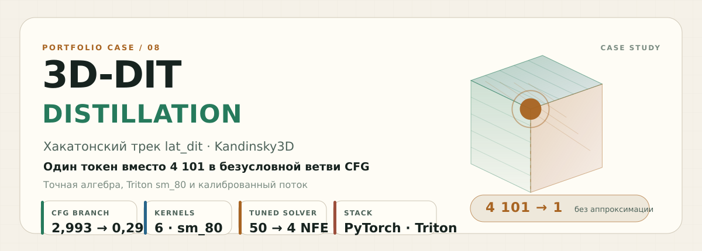
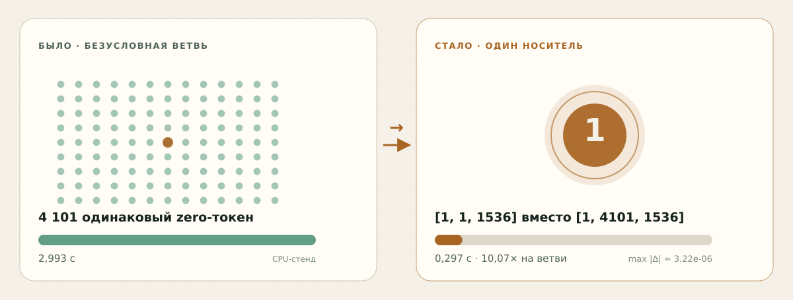
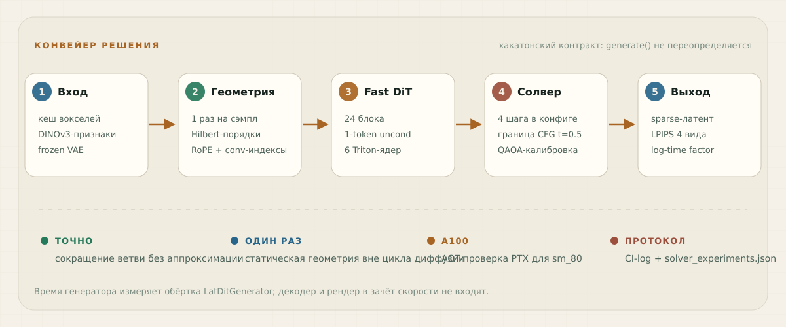
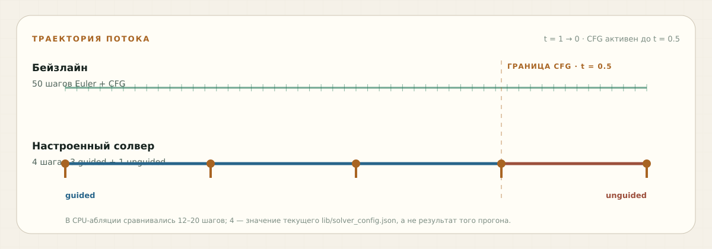

<p align="center">
  <picture>
    <source media="(prefers-color-scheme: dark)" srcset="docs/assets/portfolio/cover-dark.svg">
    
  </picture>
</p>

<div align="center">
  <a href="docs/CASE_STUDY.md"></a>
  <a href="fetched_info/ci_run.log"></a>
  <a href="docs/EVIDENCE.md"></a>
  <a href="docs/index.html"></a>
</div>

# 3D-DIT-Distillation

### Один токен вместо 4 101 в безусловной ветви CFG

> Кейс **участия в хакатонском треке `lat_dit`** (Kandinsky3D / Image23D): заменяем генератор sparse-латента, не трогая контракт организаторов, и убираем работу, которую модель повторяет тысячи раз. Оформлено как портфолио-проект: сначала наглядная идея, затем исходники и протоколы замеров.

**Навигация:** [разбор кейса](docs/CASE_STUDY.md) · [HTML-витрина](docs/index.html) · [техническое устройство](docs/TECHNICAL.md) · [что и как измерялось](docs/EVIDENCE.md) · [запуск](docs/REPRODUCE.md) · [PR #1 с исходной сдачей](https://github.com/overbaffe1/3D-DIT-Distillation/pull/1)

> [Открыть витрину через CDN ↗](https://rawcdn.githack.com/overbaffe1/3D-DIT-Distillation/main/docs/index.html) — при первом переходе `rawcdn.githack.com` может попросить подтвердить репозиторий. Локально: `make docs-serve`.

---

<a id="summary"></a>
## Коротко

| 4 101 → 1 | 2,993 с → 0,297 с | 6 ядер | 50 → 4 |
| :---: | :---: | :---: | :---: |
| точная конденсация безусловного контекста | **одна ветвь CFG** на CPU-стенде, `10,07×` | AOT-проверенные Triton-ядра `sm_80` | шагов в настроенном солвере |

Главный результат не в «магическом ускорении всей модели», а в доказуемом упрощении: в `neg_pred` все `4 101` zero-токенов контекста одинаковы на входе и остаются одинаковыми после каждого блока. Значит, вместо всего тензора `[1, 4101, 1536]` достаточно одного носителя `[1, 1, 1536]`. Это **алгебраическое равенство**, а не аппроксимация; численная проверка даёт `max |Δ| ≈ 3,22 × 10⁻⁶`.

<p align="center">
  <picture>
    <source media="(prefers-color-scheme: dark)" srcset="docs/assets/portfolio/one-token-dark.svg">
    
  </picture>
</p>

<p align="center"><sub>Схема собрана из <a href="fetched_info/solver_experiments.json">протокола</a>; это замер <b>одной безусловной ветви</b>, не end-to-end генерации. Источники и оговорки — в <a href="docs/EVIDENCE.md">EVIDENCE.md</a>.</sub></p>

---

<a id="challenge"></a>
## Задача хакатона

Организаторы дают кеш вокселей и признаки DINOv3, фиксируют `lat_vae` и измеряют только время `lat_dit.generate(...)`. Участник реализует `Solution(LatDitGenerator)` с `from_pretrained()` и `generate_impl()`; переопределять `generate()` нельзя — обёртка сама синхронизирует CUDA и пишет метаданные. В корне посылки нельзя держать `kandi3d_image23d/` и `scripts/`.

| Скрипт | Что считает |
| :--- | :--- |
| `baseline_repo/3dgen-main/scripts/hackathon/score.py` | `quality × t_gt / t_pred`, порог LPIPS `0.25` |
| `score_final.py` | `quality × (1 + log₂(t_gt / t_pred))`, порог `0.15`, `res = 1024` |

Качество — `1 − LPIPS` по четырём рендерам; при превышении порога вклад сэмпла обнуляется. Поэтому в решении есть две разные части: **точные** структурные ускорения и **калиброванный** солвер, где уже есть компромисс между числом шагов и качеством.

---

<a id="idea"></a>
## Что сделано

1. **Точная 1-token конденсация CFG** — [`lib/fast_flow.py`](lib/fast_flow.py). В безусловной ветви пропускаются `4101 × 4101` self-attention и `N × 4101` cross-attention; остаются только нужные `V`-слайсы и один-query attention.
2. **Статическая геометрия — один раз на сэмпл** — [`lib/fast_flow.py`](lib/fast_flow.py). Перестановка `SparseDownsample`, четыре Hilbert-порядка, 27-соседние `conv_indices`, 3D/2D RoPE-таблицы вынесены из цикла на 88 NFE.
3. **Шесть fused Triton-ядер** — [`lib/fast_kernels.py`](lib/fast_kernels.py). QK-RMSNorm + RoPE + Hilbert gather, 2D RoPE, gate/LayerNorm/AdaLN, packed SwiGLU, output norm/unpatchify и encoding Hilbert-кривой. CI-log содержит AOT-компиляцию в PTX для `sm_80`.
4. **Предкаст весов и тёплый старт** — [`solution.py`](solution.py). `bfloat16` для `nn.Linear`, FP32 для `ffn_conv`, кеш timestep-gate'ов и 64-воксельный warmup до начала замера.
5. **Кусочно-выровненный солвер** — [`lib/fast_sampler.py`](lib/fast_sampler.py), [`lib/solver_config.json`](lib/solver_config.json). Текущий конфиг: `4` шага = `3` guided + `1` unguided, граница CFG `t = 0.5` (`u = 0.25`) обрабатывается явно. Оптимизатор траектории и его состояние — [`tools/qaoa_optimize.py`](tools/qaoa_optimize.py) и [`qaoa_state.json`](qaoa_state.json).
6. **Инженерная обвязка** — [`tools/build_submission.py`](tools/build_submission.py), [`tools/test_solution.py`](tools/test_solution.py), [`agent_toolkit/`](agent_toolkit/README.md). Проверка формата посылки, numerical equivalence, AOT-компиляция и playbook для CI/RemoteZip.

<p align="center">
  <picture>
    <source media="(prefers-color-scheme: dark)" srcset="docs/assets/portfolio/architecture-dark.svg">
    
  </picture>
</p>

<p align="center">
  <picture>
    <source media="(prefers-color-scheme: dark)" srcset="docs/assets/portfolio/timeline-dark.svg">
    
  </picture>
</p>

---

<a id="evidence"></a>
## Что реально проверяется в этом репозитории

| Проверка | Результат | Источник |
| :--- | :--- | :--- |
| `pos_pred` fast engine vs reference | `max |Δ| = 9,54 × 10⁻⁷`, `cos = 1,00000024` | [`solver_experiments.json`](fetched_info/solver_experiments.json) |
| `neg_pred`: 1 token vs 4 101 | `max |Δ| = 3,22 × 10⁻⁶`, `2,993 с → 0,297 с`, `10,07×` | [`ci_run.log`](fetched_info/ci_run.log) |
| 6 Triton-ядер | AOT PTX для `sm_80` собран без ошибок | [`ci_run.log`](fetched_info/ci_run.log) |
| Формат посылки | `submission.zip` и корень репозитория прошли валидацию | [`ci_run.log`](fetched_info/ci_run.log) |
| Солверы 12–20 шагов | относительное сравнение с 50-шаговым учителем на CPU | [`solver_experiments.json`](fetched_info/solver_experiments.json) |

Эти замеры сделаны на **CPU-стенде с уменьшенной 2-блочной моделью** и реальными весами `flow.blocks.0.*` / одним сэмплом `public_test`. Это регрессионный стенд, а не замер пропускной способности A100. Полный разбор происхождения цифр — в [`docs/EVIDENCE.md`](docs/EVIDENCE.md).

<details>
<summary><b>Архивные баллы площадки</b> — отдельно от воспроизводимых замеров</summary>

В исходном README и [PR #1](https://github.com/overbaffe1/3D-DIT-Distillation/pull/1) указаны три публичных слота: `15.5618`, `56.7039` и `116.0542`. В этой ветке нет логов самой площадки, поэтому эти числа сохранены как **историческая заявка**, а не как главное доказательство кейса. Место в итоговой таблице и призовой статус здесь не заявляются: проект описывает участие в хакатоне и техническую работу над решением.

</details>

---

<a id="run"></a>
## Быстрый старт

```bash
# 1. Проверить оформление и regenerated-ассеты без GPU
make docs-check
make docs-assets

# 2. Собрать и проверить лёгкую посылку (использует веса организатора)
python3 tools/build_submission.py --output submission.zip
python3 tools/test_solution.py

# 3. Открыть статическую витрину локально
make docs-serve   # затем http://localhost:4173/docs/index.html
```

Для полного хакатонского прогона нужны внешние веса `kandi3d_weights_aijc_kit`, `public_test`, CUDA-стек и A100. Команды загрузки, обучения калибровки, генерации GT/студента и подсчёта score — в [`docs/REPRODUCE.md`](docs/REPRODUCE.md).

---

<a id="structure"></a>
## Структура

```text
solution.py                 # Solution(LatDitGenerator): контракт хакатона
lib/                        # fast_flow · fast_kernels · fast_sampler · solver_config.json
tools/                      # QAOA-оптимизатор, сборка посылки, тесты, загрузка данных
weights/                    # конфиг модели и синхронизированный конфиг солвера
fetched_info/               # протоколы, CI-log, сэмпл public_test, статистика весов
baseline_repo/3dgen-main/   # slim participant kit организаторов (не наш код)
submission*.zip             # проверенные архивы сдачи
agent_toolkit/              # переносимый playbook для CI и больших артефактов
docs/                       # кейс, витрина, доказательства, запуск, SVG-ассеты
```

---

<a id="design"></a>
## Об оформлении

Визуальный язык взят из [**gitEdit**](https://github.com/overbaffe1/gitEdit): тёмная/светлая обложка, собственные SVG вместо случайных картинок, ссылки с каждого утверждения на исходник и `<details>` для проверки деталей. Все схемы в [`docs/assets/portfolio/`](docs/assets/portfolio/) генерируются из [`fetched_info/solver_experiments.json`](fetched_info/solver_experiments.json) и [`lib/solver_config.json`](lib/solver_config.json) скриптом [`tools/build_portfolio_assets.py`](tools/build_portfolio_assets.py); манифест — [`manifest.json`](docs/assets/portfolio/manifest.json). [`social-preview.png`](docs/assets/portfolio/social-preview.png) готов к загрузке в **Settings → Social preview**.

`docs/index.html` — статическая страница без JS и внешних зависимостей. Её можно открыть как файл, через локальный сервер или опубликовать через GitHub Pages / `rawcdn.githack.com`.

---

<a id="limits"></a>
## Границы проекта

- `baseline_repo/3dgen-main/` — сокращённая выжимка participant kit организаторов, включённая для воспроизводимости протокола; лицензия на неё в репозитории не приложена.
- Полные веса `7.80 GB` и датасет не хранятся в Git; репозиторий содержит конфиги, один сэмпл для smoke-тестов и загрузчики.
- CPU-протокол проверяет **эквивалентность и относительную динамику солверов**, а не финальный LPIPS на 500 сэмплах.
- `qaoa_state.json` хранит внутренние метрики оптимизатора; они не выдаются за самостоятельный бенчмарк.
- Описание фиксирует факт участия в хакатоне и инженерные решения, без утверждений о победе или месте.

---

**Связанное:** [альбом портфолио, работа 08](https://github.com/overbaffe1/overbaffe1#08--один-токен-вместо-4-101) · [мастерская оформления gitEdit](https://github.com/overbaffe1/gitEdit) · [все репозитории](https://github.com/overbaffe1?tab=repositories)
