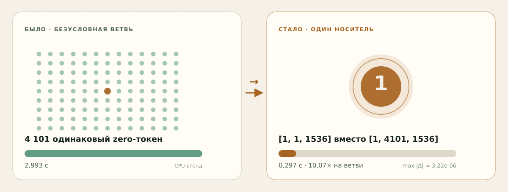
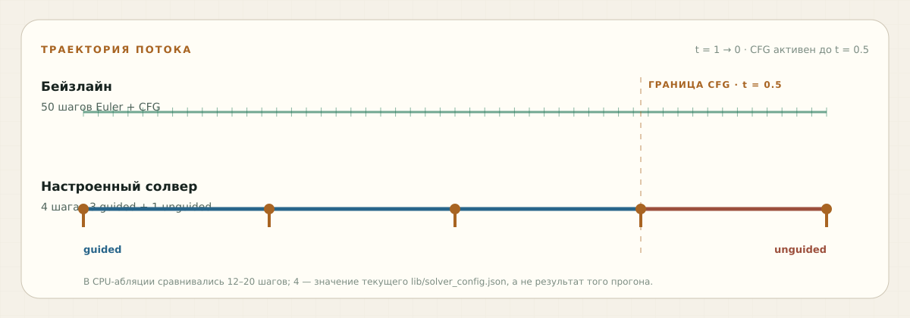

# Один токен вместо 4 101

> Работа 08 из [альбома портфолио](https://github.com/overbaffe1/overbaffe1#08--один-токен-вместо-4-101). Решение готовилось как **участие в хакатонском треке `lat_dit`** по ускорению Kandinsky3D. Ниже — не пересказ лидерборда, а разбор одного точного преобразования и инженерной обвязки вокруг него.

**Читать рядом:** [README](../README.md) · [HTML-витрина](index.html) · [техническое устройство](TECHNICAL.md) · [источники цифр](EVIDENCE.md) · [запуск](REPRODUCE.md)

  <picture>
    <source media="(prefers-color-scheme: dark)" srcset="assets/portfolio/one-token-dark.svg">
    
  </picture>

---

## 1. Что досталось на входе

Организаторы не просили обучать новую 3D-модель с нуля. Участнику выдавали уже подготовленные `vox_idxi` и признаки DINOv3, фиксировали `lat_vae` и замеряли только вызов `lat_dit.generate(...)`. Бейзлайн — `LatDitModel` на 24 блока, `50` шагов Euler, `guidance_scale = 7.0`, CFG активен на первой части траектории. Из-за двух проходов на guided-шагах получается `88` полных forward-вычислений на сэмпл.

Контракт узкий: `Solution` наследует `LatDitGenerator`, реализует `from_pretrained()` и `generate_impl()`, но **не переопределяет `generate()`** — тайминг и JSON-метаданные остаются у абстрактного класса. Это удобно для портфолио: границы чужого кода и своей оптимизации видны буквально по файлам.

| Боль | Где наблюдается |
| :--- | :--- |
| `4 101` одинаковых zero-токенов в `neg_pred` | `torch.zeros_like(context)` в безусловной ветви |
| Геометрия пересчитывается на каждом NFE | `SparseDownsample`, Hilbert-порядки, `conv_indices`, RoPE |
| Много мелких GPU/CPU kernel launches | QKNorm, RoPE, gate-add, LayerNorm, SwiGLU, unpatchify |
| Разрыв CFG на `t = 0.5` | стандартное равномерное расписание с малым числом шагов |

<small>Про происхождение participant kit: [`../baseline_repo/3dgen-main/README.md`](../baseline_repo/3dgen-main/README.md). Про контракт: [`../baseline_repo/3dgen-main/kandi3d_image23d/lat_dit_protocol.py`](../baseline_repo/3dgen-main/kandi3d_image23d/lat_dit_protocol.py).</small>

---

## 2. Вопрос, с которого всё началось

В безусловной ветви контекст — не «разные пустые признаки», а **один и тот же нулевой вектор, повторённый 4 101 раз**. Если все токены равны до блока, что будет после self-attention?

Ответ: снова равные токены. Softmax-веса по одинаковым `V` суммируются в `1`, поэтому любая выпуклая комбинация даёт тот же самый вектор. В двустороннем cross-attention воксели тоже видят `4 101` одинаковых ключей/значений: результат равен одному `V_cc` и не зависит от запроса. Индукция по 24 блокам сохраняет равенство.

<b>Развернуть короткое доказательство и указатели на код</b>

1. `cond_0 = zeros(1, 4101, 1536)`; `clf` broadcast одинаково на все токены.
2. До 2D RoPE все `Q_c`, `K_c`, `V_c` одинаковы. После поворота `Q_c` / `K_c` строки attention-матрицы по-прежнему дают сумму весов `1`.
3. `x → cond`: у `N` вокселей запросы не влияют на результат, потому что все `V_cc` равны. Достаточно одного `to_out_cross(V_cc)` и broadcast gate.
4. `cond → x`: у `4 101` одинаковых запросов будет `4 101` одинаковых ответов. Достаточно одного запроса `[1, 16, 96]`.
5. В блоках `8..23` `cond` не меняется, поэтому `layer_norm(cond)` кешируется, а безусловная ветвь работает с `[1, 1, 1536]`.

Смотреть: [`lib/fast_flow.py`, подготовка срезов](https://github.com/overbaffe1/3D-DIT-Distillation/blob/d65823d79066eb6e67a722d8a3db2f4153739ac7/lib/fast_flow.py#L195-L239), [вход в 1-token fast path](https://github.com/overbaffe1/3D-DIT-Distillation/blob/d65823d79066eb6e67a722d8a3db2f4153739ac7/lib/fast_flow.py#L937-L990), [проверка в тесте](https://github.com/overbaffe1/3D-DIT-Distillation/blob/d65823d79066eb6e67a722d8a3db2f4153739ac7/tools/test_solution.py#L135-L166).

**Это не «примерно похоже» и не distill-аппроксимация.** В протоколе максимальное расхождение выходов `neg_pred` — `3,22 × 10⁻⁶`, косинус `1,00000000`. Разница объясняется порядком плавающих операций, а не изменением математики.

---

## 3. Три решения и чем за них заплатили

| Решение | Что убрало | Цена / ограничение |
| :--- | :--- | :--- |
| 1-token `neg_pred` | `4101²` self-attention, `N × 4101` cross-attention, Q/K-проекции контекста | работает при `batch_size = 1` и нулевом unconditional-контексте; это именно контракт трека |
| Геометрия вне цикла | до `2 112` пересчётов `conv_indices`, `352` Hilbert-разбиений, тысячи RoPE-вызовов | нужно аккуратно сохранить перестановку шума, иначе сэмпл «уедет» от учителя |
| Fused Triton `sm_80` | отдельные launches QKNorm/RoPE/gate/LN/SwiGLU/unpatchify | ядра привязаны к архитектуре A100; для CPU-стенда есть AOT-проверка PTX, но не замер скорости |

Дальше идут уже **приближённые** части: солвер с малым числом шагов, кеширование признаков и QAOA-калибровка. Их нельзя выдавать за точные: в [`../fetched_info/solver_experiments.json`](../fetched_info/solver_experiments.json) у 12–20-шаговых конфигураций `rel_l2` от `0,22` до `0,40` относительно 50-шагового учителя. Текущий [`../lib/solver_config.json`](../lib/solver_config.json) настроен на `4` шага: `3` guided + `1` unguided, `cfg_stride = 2`, `cfg_cache_mode = "neg_reuse"`.

  <picture>
    <source media="(prefers-color-scheme: dark)" srcset="assets/portfolio/timeline-dark.svg">
    
  </picture>

---

## 4. Как это проверяли

CI-скрипт [`../.github/scripts/verify_teacher_and_solvers.py`](../.github/scripts/verify_teacher_and_solvers.py) не скачивает все `7.80 GB` весов: он читает по HTTP Range реальные тензоры `flow.blocks.0.*`, собирает уменьшенную 2-блочную модель, берёт один сэмпл из `fetched_info/sample_test_data/public_test` и сравнивает выходы на CPU.

| Что сравнивали | Результат |
| :--- | :--- |
| reference `pos_pred` vs fast engine | `max |Δ| = 9,54 × 10⁻⁷`, `cos = 1,00000024` |
| reference `neg_pred` vs 1-token | `max |Δ| = 3,22 × 10⁻⁶`, `cos = 1,00000000` |
| время `neg_pred` | `2,993 с → 0,297 с`, `10,07×` |
| 6 Triton-ядер | AOT PTX `sm_80` собран для всех шести |

Ключевая оговорка, уже сделанная в профильном README: **это ускорение одной ветви вычислений, не всей генерации и не A100-бэнчмарк**. Протокол: [JSON](https://github.com/overbaffe1/3D-DIT-Distillation/blob/d65823d79066eb6e67a722d8a3db2f4153739ac7/fetched_info/solver_experiments.json#L2-L12) · [CI-log](../fetched_info/ci_run.log) · [полный разбор](EVIDENCE.md).

---

## 5. Что осталось за кадром

В исходной сдаче и [PR #1](https://github.com/overbaffe1/3D-DIT-Distillation/pull/1) фигурируют публичные баллы площадки `15.5618`, `56.7039`, `116.0542` и внутренние метрики `qaoa_state.json`. В этом кейсе они вынесены в архивный слой: логов самой площадки в ветке нет, поэтому главным доказательством служит воспроизводимый CPU-протокол. Такой раздел честнее для портфолио, чем крупная цифра без источника.

Также в репозитории есть [`../agent_toolkit/README.md`](../agent_toolkit/README.md) — отдельный переносимый результат хакатона: как наблюдать за GitHub Actions, читать гигабайтные `.safetensors` через HTTP Range, резать артефакты и компилировать Triton на CI-раннере без GPU. Это уже не про математику DiT, а про то, как довести решение до посылки.

---

## 6. Что можно вынести в портфолио

- **Профилирование до оптимизации.** Сначала найден повтор `4 101` одинаковых токенов и `88` NFE, потом появились ядра.
- **Различение exact и approximate.** 1-token CFG доказан; сокращение шагов честно помечено как компромисс по `rel_l2`.
- **Работа внутри чужого контракта.** `generate()` не тронут, запрещённые корневые директории не попали в `submission.zip`.
- **Проверяемость.** Каждая крупная цифра ссылается на JSON/CI-log; схемы генерятся из тех же файлов.
- **Оформление как часть инженерии.** SVG, светлая/тёмная тема и статическая витрина сделаны по образцу [gitEdit](https://github.com/overbaffe1/gitEdit), но не копируют его ассеты.

---

[← Вернуться в README](../README.md) · [Открыть витрину](index.html) · [Проверить цифры](EVIDENCE.md)
