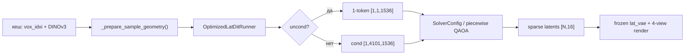

# Техническое устройство решения

Подробный слой для тех, кто хочет открыть код после [кейса](CASE_STUDY.md). Здесь нет архивных баллов площадки: только то, что можно свести к файлам, конфигурации и протоколу проверки.

**См. также:** [README](../README.md) · [источники цифр](EVIDENCE.md) · [запуск](REPRODUCE.md)

---

## 1. Контракт и точка входа

[`../solution.py`](../solution.py) объявляет `Solution(LatDitGenerator)`:

- `from_pretrained()` ищет `diffusion_pytorch_model.safetensors` / `.bin` в `weights/`, в `--lat-dit-dir`, в переменных окружения и стандартных путях организатора;
- загружает `LatDitConfig`, создаёт `LatDitModel`, применяет `normalize_state_dict`, при наличии folding-адаптеров (`student_adapter.pt`) вливает их в веса до инференса;
- создаёт `OptimizedLatDitRunner` и `SolverConfig`, затем выполняет `warmup()` до первого тайминга;
- `generate_impl()` вызывает `resolve(...)` и передаёт управление быстрому runner'у;
- `generate()` **не переопределён**: синхронизация CUDA, замер времени и `last_run_metadata` остаются у [`LatDitGenerator`](../baseline_repo/3dgen-main/kandi3d_image23d/lat_dit_protocol.py).



---

## 2. Что дорого в бейзлайне

Оценки ниже — статический подсчёт по `weights/config.json` и коду `FlowModel`, а не замер профилировщика.

| Бутылочное горлышко | Масштаб на сэмпл |
| :--- | :--- |
| 50 Euler + CFG на `t ∈ [0.5, 1.0]` | `38 × 2 + 12 × 1 = 88` полных forward-проходов |
| Нулевой unconditional context | `[1, 4101, 1536]` вместо одного вектора |
| Hilbert-разбиения | `4 × 88 = 352` вызова `calc_order_partition` |
| 3D submanifold conv | `24 × 88 = 2 112` построений `conv_indices` |
| 3D/2D RoPE | до `4 224` launches `rope_nd` |
| FP32 веса | `7,80 GB` / `636` тензоров, autocast кастует их на лету |
| `layer_norm(cond)` в блоках 8–23 | `16` повторов за NFE при неизменном `cond` |
| Граница CFG | `t = 0.5` ↔ `u = 0.25` при `rescale_t = 3` |

Формула `t = 3u / (1 + 2u)` делает границу не кратной равномерной сетке из малого числа шагов, поэтому солвер делит траекторию на две гладкие части.

---

## 3. Six pillars

### 3.1 Exact 1-token unconditional condensation

Файл: [`../lib/fast_flow.py`](../lib/fast_flow.py), вход в fast path около строк `937–990` в базовом коммите.

Идея: `cond = zeros(1, 4101, 1536)` и одинаковый `clf` ⇒ все `Q_c, K_c, V_c` равны. Softmax по одинаковым values даёт тот же `V_c`; в `x ↔ cond` cross-attention ответы тоже не зависят от дублирования. По индукции все 24 блока сохраняют один и тот же вектор.

Реализация хранит:

- `_cond_to_v_w` — только V-слайс `cond_to_qkv`;
- `_to_kv_cross_w` — K/V-слайсы для `[N, 2, 16, 96]`;
- `_cond_1tok_msa_w`, `_cond_1tok_q_and_out_cr_w`, `_cond_1tok_cr_w` — свёрнутые 1-token веса;
- `_noncond_1tok_w_t`, `_noncond_1tok_b` — перенесённые линейные члены.

В блоках `0..7` пропускаются Q/K-проекции cond, `4101²` self-attention и `N × 4101` cross-attention; в `8..23` — `to_q_cross(x)`, FlashAttention и повторный `layer_norm(cond)`. Результат — тот же `cr_uncond[b]`, используемый в CFG-разности `g_cr[b] · (cr_pos[b] − cr_uncond[b])`.

### 3.2 Per-sample static geometry hoisting

`_prepare_sample_geometry()` один раз до цикла считает:

- `perm` / `up_widx` из `SparseDownsample(patch_size=1)`; начальный шум переставляется один раз, чтобы каждый воксель получил тот же random draw, что и учитель;
- четыре порядка `["h", "ht1", "h1", "ht"]`;
- `conv_indices` для 27-соседнего `SparseConv3d`;
- таблицы `cos_vox/sin_vox` и `cos_cond_2d/sin_cond_2d`;
- кэш gate-параметров timestep embeddings для расписания.

### 3.3 Fused Triton kernels

[`../lib/fast_kernels.py`](../lib/fast_kernels.py), шесть AOT-проверенных ядер из [`../fetched_info/ci_run.log`](../fetched_info/ci_run.log):

| Ядро | Что сливает |
| :--- | :--- |
| `_encode_hilbert_4_kernel` | кодирование 4 Hilbert-порядков |
| `_fused_qknorm_rope3d_gather_kernel` | RMSNorm(q/k) + scale + 3D RoPE + Hilbert gather |
| `_fused_qknorm_rope2d_cond_inplace_kernel` | 2D RoPE + QK-RMSNorm для cond-токенов |
| `_fused_gate_add_ln_modulate_kernel` | residual gate-add + LayerNorm + AdaLN |
| `_fused_packed_swiglu_kernel` | packed SwiGLU с 64-битной адресацией |
| `_fused_out_modulate_unpatchify_kernel` | output LayerNorm + unpatchify |

Дополнительно `preload_extensions()` подгружает `libsparse`/`curope`, а `ffn_conv` остаётся в contiguous FP32 и вызывается напрямую через `_libsparse.conv_fwd` с готовыми индексами.

### 3.4 Pre-cast weights, gate cache, warmup

[`../solution.py`](../solution.py) переводит `nn.Linear` в contiguous `bfloat16` на GPU при загрузке, кеширует `gates(clf)` / `cond_gates(clf)` / `out_gates(clf)` для всех 24 блоков и делает 64-воксельный untimed прогон. Цель — убрать из тайминга и каст `7,80 GB`, и JIT-компиляцию ядер.

### 3.5 Piecewise solver и калибровка

[`../lib/fast_sampler.py`](../lib/fast_sampler.py) содержит `SolverConfig` и солверы `euler`, `piecewise_euler`, `piecewise_ab2`, `piecewise_qaoa`. Текущий [`../lib/solver_config.json`](../lib/solver_config.json):

```json
{
  "num_inference_steps": 4,
  "n_guided_steps": 3,
  "n_unguided_steps": 1,
  "solver_type": "piecewise_qaoa",
  "cfg_stride": 2,
  "cfg_cache_mode": "neg_reuse"
}
```

Граница `u = 0.25` делит расписание на guided/unguided сегменты; история многошагового метода сбрасывается на разрыве CFG. `cfg_stride = 2` и `neg_reuse` означают повтор/экстраполяцию безусловной ветви на части шагов — это уже **приближение**. В конфиге также включены feature-cache флаги, QMC-stride'ы и компенсаторы траектории; их названия отражают исследовательские приёмы, но в этом документе они не привязаны к внешним публикациям.

Оптимизатор [`../tools/qaoa_optimize.py`](../tools/qaoa_optimize.py) подбирает параметры расписания и сохраняет состояние в [`../qaoa_state.json`](../qaoa_state.json) (`generation = 153`). Внутренние `best_metrics` не являются самостоятельным бенчмарком — см. [EVIDENCE.md](EVIDENCE.md).

### 3.6 Distillation hooks

[`../tools/train_distill.py`](../tools/train_distill.py) умеет:

- калибровать per-step channel-wise velocity (`weights/step_calibration.pt`);
- обучать low-rank adapters (`weights/student_adapter.pt`);
- folding адаптеров в базовые веса выполняется в `from_pretrained`, поэтому во время `generate()` нет дополнительных matmul'ов LoRA.

---

## 4. Посылка и проверки

[`../tools/build_submission.py`](../tools/build_submission.py) собирает архив по правилам [`submission_format.py`](../baseline_repo/3dgen-main/scripts/hackathon/submission_format.py):

- допускает `solution.py`, `weights/`, `lib/`;
- запрещены корневые `kandi3d_image23d/` и `scripts/`;
- пустой `weights/` допустим: тогда eval использует `--lat-dit-dir` организатора;
- [`../tools/test_solution.py`](../tools/test_solution.py) проверяет формат, equivalence, контракт и AOT PTX `sm_80`;
- [`../agent_toolkit/README.md`](../agent_toolkit/README.md) документирует CI, RemoteZip, chunking `< 45 MB` и CPU-компиляцию Triton.

Архивы: [`../submission.zip`](../submission.zip) (с `agent_toolkit/`), [`../submission_final_q015.zip`](../submission_final_q015.zip) (минимальный вариант под `q_min = 0.15`).

---

## 5. Известные ограничения

- 1-token condensation использует `batch_size = 1` и нулевой unconditional context; для другого контракта доказательство надо перепроверять.
- Triton-ядра нацелены на `sm_80`; AOT-проверка в CI подтверждает компиляцию PTX, но не измеряет GPU latency.
- CPU-стенд использует уменьшенную модель и `69` cond-токенов в солверном прогоне; его `speedup_vs_teacher` нельзя переносить на A100.
- Полные веса и `public_test` не включены в Git; для финального LPIPS нужен внешний датасет и CUDA-стек.
- `baseline_repo/` — чужая выжимка participant kit без приложенной лицензии; она оставлена только как эталон.

---

[← Кейс](CASE_STUDY.md) · [Источники цифр](EVIDENCE.md) · [Запуск →](REPRODUCE.md)
